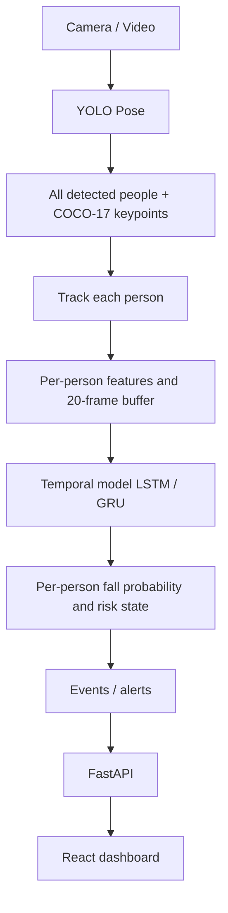

# PatientSafetyAI

Privacy-conscious hospital patient safety and **fall-risk monitoring** prototype.

This is an **academic / research** system for fall detection and early warning
using human pose keypoints and temporal models. It is **not** a clinically
validated medical device and must not be described as guaranteed medical-grade
fall prevention or diagnosis.

## Problem statement

Hospital falls are a major patient-safety concern. Continuous raw-video storage
raises privacy issues. PatientSafetyAI prefers:

```text
Camera / video
    → YOLO Pose (person + keypoints)
    → skeleton / keypoint analysis
    → temporal risk estimation
    → alerts + dashboard
```

over pipelines that archive identifiable raw video by default.

## Planned end-to-end architecture



## Current progress

- UP-Fall sequences use a subject-wise train / validation / test split.
- The monitor processes up to the configured maximum number of people, with
  separate sequence, risk, and event state per tracking ID.
- YOLO tracking uses ByteTrack when available and an IoU fallback otherwise.
- FastAPI and the React dashboard expose per-person status and inference
  telemetry; the dashboard draws keypoints, not raw video.
- A controlled 99-feature baseline vs. 34-feature COCO-17 XY experiment was
  evaluated on SUBJECT5 after selecting thresholds on SUBJECT4.
- The live configuration remains on the existing 99-feature model. The XY
  candidate trades lower fall recall for fewer false alarms and is not yet a
  default deployment choice.

## Repository layout

```text
PatientSafetyAI/
├── config/config.yaml
├── datasets/
├── processed/
├── models/
├── src/
│   ├── pose/
│   ├── features/       # COCO-17, UP-Fall 99, buffer, train-stat normalize
│   ├── temporal/       # LSTM inference
│   ├── risk/
│   ├── alerts/
│   ├── tracking/
│   ├── zones/
│   ├── pipeline/       # FrameMonitor
│   └── utils/
├── backend/            # FastAPI
├── frontend/           # React (Vite)
├── scripts/
├── tests/
├── demo.py             # full pipeline demo
├── demo_pose.py        # pose-only demo
└── requirements.txt
```

Legacy inspection / preprocessing scripts at the repo root are **preserved**
(`inspect_*.py`, `clean_dataset.py`, `prepare_sequences.py`, `split_dataset.py`,
`normalize_data.py`, `train_lstm.py`, `evaluate_model.py`).

> **Note:** Some older scripts still contain absolute `D:\PatientSafetyAI\...`
> paths from earlier development. New code uses project-relative paths via
> `config/config.yaml` and `src/utils/paths.py`.

## Dataset (UP-Fall)

Uses the [UP-Fall Detection Dataset](https://sites.google.com/up.edu.mx/har-up/)
skeleton/keypoint CSVs.

**Representation used by the current LSTM:**

- 33 joints × `(X, Y, Z)` = **99 features per frame**
- Sequences: **20 frames**, step size 5 during preparation
- Subject-wise split:
  - Train: SUBJECT1–3 → 1037 sequences
  - Validation: SUBJECT4 → 85 sequences
  - Test: SUBJECT5 → 272 sequences
- Labels (binary, within A1–A5 fall recordings):
  - `0` ≈ fall-phase frames (minority)
  - `1` ≈ non-fall frames

Normalization uses **training statistics only** (`normalization_mean.npy`,
`normalization_std.npy`). Never recompute stats on the test set.

## Fall-model evaluation (kept for comparison)

Files (local; may be gitignored):

- `models/upfall_lstm_best.keras`
- `models/upfall_lstm_final.keras`

The previously evaluated model at the default 0.5 threshold scored on SUBJECT5:

- Accuracy: **57.35%**
- Fall precision: **8.65%**
- Fall recall: **30.00%**
- Fall F1: **13.43%**
- Confusion matrix (rows actual fall / non-fall; columns predicted fall / non-fall):
  `[[9, 21], [95, 147]]`

The controlled retraining experiment uses SUBJECT1–3 for training,
SUBJECT4 for checkpoint / threshold selection, and SUBJECT5 once for final
evaluation (30 fall and 242 non-fall windows). Thresholds were selected on
validation data only. However, earlier project work evaluated the prior
baseline and swept thresholds on SUBJECT5. It is not a pristine project-wide
holdout; treat this comparison as exploratory. Class 0 is the fall class:

- **99-feature baseline** (threshold 0.56; 44,097 parameters): accuracy
  **51.47%**, fall precision **12.50%**, fall recall **56.67%**, fall F1
  **20.48%**, false-positive rate **49.17%**.
- **COCO-17 XY candidate** (threshold 0.51; 27,457 parameters): accuracy
  **70.22%**, fall precision **15.07%**, fall recall **36.67%**, fall F1
  **21.36%**, false-positive rate **25.62%**.

The candidate improves accuracy, fall precision, fall F1, and false-alarm rate,
but misses more falls than the retrained baseline. The dataset is small and
subject-specific; neither result establishes clinical reliability. Full
metrics, classification reports, confusion matrices, and the comparison CSV
are in `results/fall_experiment_20261115T134158Z/`.

### Critical feature-format warning

| Source | Format |
| --- | --- |
| UP-Fall LSTM | 33 joints × XYZ → shape `(20, 99)` |
| YOLO Pose | COCO-17 × (x, y, conf) |

These are **not interchangeable**. Live video uses an **explicit approximate**
mapping in `src/features/yolo_to_upfall.py` (derived Kinect-style 33 joints,
**Z = 0**, unused joints copied or zeroed). Training-set mean/std are then
applied. Live LSTM scores are **domain-shifted** and must not be compared
directly to the SUBJECT5 Kinect test metrics.

The COCO-17 XY candidate removes synthetic depth channels and repeated joint
features, but its UP-Fall-to-COCO joint projection is still approximate. It
does not establish performance on live camera data or eliminate sensor and
coordinate-domain shift.

## Risk score (prototype)

Configurable weights in `config/config.yaml`:

```text
risk =
    w_lstm    * lstm_fall_probability     (1 - P(class=1); class 0 = fall)
  + w_posture * clip(torso_angle / 90°)
  + w_vertical* clip(downward hip velocity / v_ref)
  + w_height  * (1 - clip(body_height / h_ref))
  + w_aspect  * clip((bbox_width/height - 0.6) / 1.2)
  + w_zone    * zone_prior
```

If the LSTM is missing, remaining weights are renormalized. A **FALL_DETECTED**
event is emitted only if `risk >= fall_threshold` for `min_consecutive_frames`.
PRE-FALL / MEDIUM is a **heuristic state**, not a trained third class.

## YOLO Pose + full pipeline

```text
Video / webcam / image
    → YOLO11n-Pose (CPU) + multi-person tracking
    → per-person COCO-17 keypoints and 20-frame buffer (stride 5)
    → LSTM P(fall) + pose signals + independent risk state
    → per-person events and dashboard cards
    → events (in memory)
```

### Install

```bash
pip install -r requirements.txt
```

Weights: `models/yolo11n-pose.pt` and `models/upfall_lstm_best.keras`.
For Windows PowerShell setup and the complete three-terminal run sequence,
see [`run_commands.txt`](run_commands.txt).

### Demo

```bash
# Pose-only
python demo_pose.py --image datasets/samples/bus.jpg --no-display

# End-to-end risk HUD
python demo.py --source datasets/samples/bus_clip.mp4 --no-display --max-frames 25
python demo.py --source 0
```

### API + dashboard

Start the backend, frontend, and optional webcam/video publisher in separate
terminals using [`run_commands.txt`](run_commands.txt). The backend requires
`PATIENTSAFETYAI_SECRET_KEY` to be set before startup.

Endpoints: `POST /auth/signup`, `POST /auth/login`, `GET /auth/me`,
`GET /health`, `POST /predict/frame`, `POST /predict/video`,
`GET /risk`, `GET /monitor/state`, `GET /events`, `GET /events/latest`,
`GET /events/acknowledgements`, `POST /events/{event_id}/acknowledge`,
`GET /patients`, `GET /rooms`, `POST /rooms`, `GET/PUT /settings`,
`POST /camera/start`, `POST /camera/stop`, `GET /camera/status`, and
`WS /ws/monitor`. Dashboard, settings, event, room, and camera-control routes
require a bearer token from login; `/health`, auth routes, and the pose-frame
ingest route remain available for startup, account access, and the local demo.

### Tests

```bash
python -m pytest tests -q -k "not slow"
```

The API tests set a local-only signing key in their test fixture. For Windows
setup, use the matching command in `run_commands.txt`.

Versioned LSTM evaluation and validation-only threshold selection:

```bash
python scripts/evaluate_baseline.py
python scripts/tune_decision_threshold.py   # SUBJECT4 validation only
python scripts/train_fall_experiment.py
python scripts/evaluate_fall_experiment.py --experiment results/fall_experiment_<timestamp>
```

## Privacy architecture

Preferred path stores **keypoints / events / risk metadata**, not raw video.

- Default: do not save raw video
- Optional `--save-keypoints`: pose JSONL only
- Optional `--save-vis`: annotated video (identifiable — use only when needed)

Wording: **privacy-conscious** architecture that **minimizes** storage of
identifiable video — not “100% privacy”.

## Configuration

See `config/config.yaml` for YOLO, sequence length/stride, risk thresholds
and weights, zone rectangles, model path, API host/port.

## Evaluation protocol

- Subject-wise holdout (SUBJECT5 never in training)
- Checkpoint and threshold selection use SUBJECT4 only
- Preprocessing statistics from **train only**
- Final experiment test metrics evaluated once on SUBJECT5
- Report accuracy, precision, recall, F1, confusion matrix, class counts, FPR/FNR

## Limitations

- Binary labels only (no trained PRE-FALL class)
- Baseline LSTM is weak on class 0 and **not** production-ready
- YOLO→UP-Fall mapping is approximate (no depth, joint mismatch, domain shift)
- Room zones are uncalibrated rectangles
- Dashboard draws **normalized keypoints**, not a camera JPEG (opt-in snapshots remain off)
- Not clinically validated

## Next steps

1. Train a temporal model on YOLO-native features (avoid Kinect domain shift)
2. Apply a chosen SUBJECT5 operating point in `config.yaml` `model.decision_threshold` after reviewing FPR
3. Calibrate rooms/zones; optional MongoDB persistence
4. Optional privacy-flagged JPEG snapshots (off by default)

## Technologies

- Python, NumPy, Pandas, scikit-learn, TensorFlow/Keras
- Ultralytics YOLO Pose, OpenCV
- FastAPI, React (Vite)
